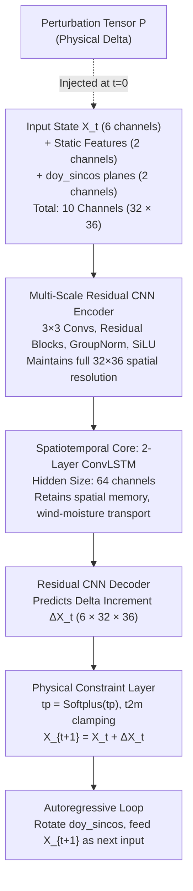

# Track 2: Multiverse of Monsoon — Project Execution Plan

> **Hackathon:** Yugaantar DevForge 2026 — Track 2  
> **Project Name:** MonsoonFlow-10 (MF10) & Monsoon Multiverse  
> **Goal:** Build a compact, physics-aware spatiotemporal climate digital twin capable of 10-day autoregressive rollouts and localized counterfactual shock simulations under offline CPU constraints.

---

## 1. Problem Statement & Constraint Analysis

### 1.1 Core Problem Formulation
The goal of Track 2 is to forecast regional Indian weather patterns forward in time across multiple lead days while supporting interactive, localized initial-condition perturbations ("weather shocks").

- **Spatial Grid:** 
  - $32 \times 36$ regular spatial grid ($1^\circ \times 1^\circ$ resolution).
  - Latitude: $6.5^\circ\text{N} \dots 37.5^\circ\text{N}$ ($N_{\text{lat}} = 32$, South to North).
  - Longitude: $65.5^\circ\text{E} \dots 100.5^\circ\text{E}$ ($N_{\text{lon}} = 36$, West to East).
  - Covers the entire Indian subcontinent and neighboring oceanic moisture sources (Arabian Sea and Bay of Bengal).
- **Temporal Horizon:**
  - Input: Past 3 consecutive daily weather states ($T_{\text{in}} = 3$, $t_{-2}, t_{-1}, t_0$).
  - Target: Forward autoregressive rollout of at least 10 days ($T_{\text{rollout}} = 10$, $t_1 \dots t_{10}$).
- **The 6 Dynamic Weather Channels (Physical Units on Wire):**
  1. `t2m`: 2-metre air temperature ($K$, range $[233.15, 333.15]$ K).
  2. `tp`: Total precipitation ($\text{mm/day}$, $24\text{ h}$ accumulation, strictly non-negative $\ge 0$).
  3. `u10`: 10-metre zonal (east-west) wind component ($\text{m/s}$).
  4. `v10`: 10-metre meridional (north-south) wind component ($\text{m/s}$).
  5. `msl`: Mean sea-level pressure ($\text{Pa}$).
  6. `tcwv`: Total column water vapour ($\text{kg/m}^2$, strictly non-negative $\ge 0$).
- **The 2 Static Environmental Channels:**
  1. `land_sea_mask`: Binary/fractional land indicator ($0 = \text{ocean}, 1 = \text{land}$).
  2. `orography_m`: Surface elevation / topography in meters ($m$).
  *(Note: Static channels are extracted once from training data and bundled locally; they are NOT transmitted over the API).*
- **Temporal Cyclic Conditioning (`doy_sincos`):**
  - Continuous day-of-year representation: $[\sin(2\pi \cdot \text{doy}/365), \cos(2\pi \cdot \text{doy}/365)]$.
  - Rotated forward at each rollout step $k$ to convey monsoon seasonal progression (onset, active, break, withdrawal).

---

## 2. Competition Scoring Architecture & Win Conditions

The submission is evaluated on a **100-Point Grader** consisting of 8 blind evaluation calls (5 real validation windows from post-2023 dates + 3 shock calls on a single window):

```
┌────────────────────────────────────────────────────────────────────────┐
│                      TOTAL SCORE: 100 POINTS                           │
├──────────────────────────┬─────────────────────────┬───────────────────┤
│ Forecast Skill (45 pts)  │ Dynamics & Shock (25)   │ Repo & Brief (30) │
│ • 30 pts: Lat-RMSE Skill │ • 10 pts: Anti-Blur     │ • 15 pts: Static  │
│   (SS >= 0.12 vs best    │   (Day-8 Var Ratio      │   Repo Scan       │
│    of persist/clim)      │    0.40 .. 2.50)        │ • 15 pts: 2-Page  │
│ • 15 pts: Heavy-Rain CSI │ • 15 pts: Perturbations │   PDF Brief       │
│   (>= 10 mm/day, SS>=0.1)│   (Causality checks)    │                   │
└──────────────────────────┴─────────────────────────┴───────────────────┘
```

### 2.1 Hard Admission Gate (Pass/Fail)
1. **Beat Persistence at Day 4** on latitude-weighted RMSE.
2. **Physical Validity across all 8 calls:** Exact tensor shape `(10, 6, 32, 36)`, all values finite (zero NaNs / Infs), $tp \ge -10^{-6}$, and $t2m \in [233.15, 333.15]\text{ K}$.
3. **Produce Non-Zero, Localized Response** to at least one physical shock.

### 2.2 Priority 1: Forecast Skill (45 Points)
- **Latitude-Weighted RMSE Skill Score (30 pts):**
  $$\text{SS} = 1 - \frac{\text{RMSE}_{\text{model}}}{\min(\text{RMSE}_{\text{persist}}, \text{RMSE}_{\text{clim}})}$$
  Evaluated across lead days 1, 4, and 8 over all 6 channels. Full points earned at mean $\text{SS} \ge 0.12$.
- **Heavy-Rainfall CSI (15 pts):**
  Critical Success Index at threshold $\ge 10.0\text{ mm/day}$ on lead days 1, 4, and 8. Full points earned at $\text{CSI\_SS} \ge 0.10$ over reference.

### 2.3 Priority 2: Dynamics & Multiverse Causality (25 Points)
- **Anti-Blur Variance Ratio (10 pts):**
  At Day 8, spatial variance ratio $\operatorname{Var}(\hat{X}_{\text{pred}}) / \operatorname{Var}(X_{\text{true}})$ must satisfy $0.40 \le \text{ratio} \le 2.50$. (Prevents mean-squared-error blur collapse while penalizing fake noise injection).
- **Perturbation Causality (15 pts):**
  Evaluates 2 physical shocks (`warm_ocean` Bay of Bengal $+3\text{K}$, `monsoon_stall` Arabian Sea $-40\%$ winds) and 1 `zero_shock`:
  1. `nonzero`: Peak standardized response $\max |\Delta / \sigma| \ge 10^{-3}$.
  2. `localized`: Day-1 response energy within 3 grid cells of shock box $\ge 60\%$.
  3. `propagates`: Outward spatial energy grows by Days 4–8 ($> 1.5\times$ Day 1) with **zero teleportation** (radial speed $\le 8.0$ grid cells/day).
  4. `stable`: Maximum response amplification $\le 5.0\sigma$.
  5. `null_consistent`: When $P = 0$, maximum output delta $\le 10^{-3}\sigma$. (Failing this halves the entire causality score).

### 2.4 Priority 3: Repository Correctness & Anti-Cheat (15 Points)
- Zero external weather imports or external HTTP requests (`open-meteo`, `cdsapi`, `weatherbench2`, etc.).
- Strict offline compliance (`--network none`, 4 CPU cores, 6 GB RAM, $\le 5.0\text{ s}$ per 10-step call).
- Weight file ($> 1\text{ KB}$) committed inside `checkpoints/model.pt`.
- Raw `.nc` files excluded from git repository (repo size strictly $< 2\text{ GB}$).
- Zero hardcoded date literals ($< 5$ in entire codebase).

### 2.5 Priority 4: Project Brief (15 Points)
- 2-page PDF brief documenting MF10 architecture, curriculum training, physical losses, failure modes, and the Multiverse UI impact exploration (flood risk and crop stress).

---

## 3. Recommended Neural Architecture: MonsoonFlow-10 (MF10)

Rather than deploying a massive transformer or high-latency diffusion model that exceeds CPU budget, MF10 is a **compact, hybrid spatiotemporal neural network** specifically tuned for regional monsoon dynamics:



### 3.1 Architectural Specifications
1. **Input Representation (10 Channels):**
   - 6 Dynamic variables ($t_0$)
   - 2 Static terrain planes (`land_sea_mask`, `orography_m`)
   - 2 Cyclic temporal planes ($[\sin(\theta_t), \cos(\theta_t)]$)
2. **Spatial Encoder:**
   - Preserves $32 \times 36$ spatial grid without downsampling pooling layers so fine rainbands along the Western Ghats and orographic gradients are preserved.
   - 3 Residual blocks with `GroupNorm` and `SiLU` activations expanding from 10 to 64 channels.
3. **Temporal Dynamics Core:**
   - 2-layer ConvLSTM (64 hidden channels, $3 \times 3$ convolutional kernels).
   - Encodes continuous atmospheric state evolution and moisture advection.
4. **Residual Prediction Decoder:**
   - Predicts state differences: $\hat{X}_{t+1} = X_t + \Delta X_t$.
   - Allows identity preservation across rollouts and stable propagation.
5. **Physical Enforcements:**
   - Non-negative precipitation enforcement via `Softplus` or zero-clamping: $\hat{tp} = \max(\hat{tp}, 0)$.
   - Temperature safeguard clamping to physical atmospheric regime $[233.15, 333.15]\text{ K}$.

---

## 4. Physics-Aware Training Strategy & Loss Engineering

Standard Mean Squared Error (MSE) triggers severe spatial blurring over 10-day rollouts and suppresses heavy convective rainfall. MF10 employs a **multi-objective composite loss**:

$$\mathcal{L}_{\text{total}} = \lambda_{\text{forecast}} \mathcal{L}_{\text{forecast}} + \lambda_{\text{rain}} \mathcal{L}_{\text{rain}} + \lambda_{\text{var}} \mathcal{L}_{\text{var}} + \lambda_{\text{grad}} \mathcal{L}_{\text{grad}}$$

1. **Latitude- and Channel-Weighted Forecast Loss ($\mathcal{L}_{\text{forecast}}$):**
   Matches `scoring.py` directly by weighting errors with $\cos(\text{latitude})$ and normalizing each channel by training standard deviation $\sigma_c$:
   $$\mathcal{L}_{\text{forecast}} = \frac{1}{B \cdot C \cdot H \cdot W} \sum_{b,c,i,j} \cos(\text{lat}_i) \left(\frac{\hat{X}_{b,c,i,j} - X_{b,c,i,j}}{\sigma_c}\right)^2$$
2. **Heavy-Rainfall Threshold Loss ($\mathcal{L}_{\text{rain}}$):**
   Penalizes missed rainfall above $10.0\text{ mm/day}$ using log-transformed intensities $\log(1 + tp)$ and higher weights on extreme-precipitation pixels to maximize CSI.
3. **Anti-Blur Spatial Variance Loss ($\mathcal{L}_{\text{var}}$):**
   Explicitly penalizes loss of spatial variance at later rollout days ($t \ge 5$):
   $$\mathcal{L}_{\text{var}} = \sum_{c} \max\left(0, 0.55 - \frac{\operatorname{Var}_{\text{spatial}}(\hat{X}_{t,c})}{\operatorname{Var}_{\text{spatial}}(X_{t,c}) + \epsilon}\right)^2$$
   Targeting $\ge 0.55$ guarantees passing the competition's $0.40$ threshold safely.
4. **Spatial Gradient Preservation ($\mathcal{L}_{\text{grad}}$):**
   Sobel edge difference loss to preserve frontal boundaries, pressure troughs, and sharp coastal gradients.

---

## 5. Phased Project Execution Roadmap

```mermaid
gantt
    title DevForge Track 2 Hackathon Timeline
    dateFormat  X
    axisFormat %s
    section Phase 0: Setup
    Lock Rules & Scaffolding (CLAUDE.md, kit)       :p0, 0, 1
    section Phase 1: Data & Baselines
    Data Slicing, Stats, Climatology, Baselines      :p1, 1, 3
    section Phase 2: Model Training
    MF10 Architecture & 4-Stage Curriculum Training  :p2, 3, 7
    section Phase 3: Shocks & Serving
    Shock Engine, Root serve.py & CPU Latency        :p3, 7, 9
    section Phase 4: Frontend Dashboard
    Digital Twin UI, Multiverse Lab, Impact Module  :p4, 6, 10
    section Phase 5: Verification & Brief
    Sealed Holdout Eval, Repo Scan, 2-Page Brief     :p5, 10, 12
```



### Phase 0: Pre-Flight Lock-In & Governance
- **Deliverables:** Root `CLAUDE.md`, `.gitignore`, directory scaffolding.
- **Rules Locked:**
  - `serve.py` lives at repository root, listening on `0.0.0.0:8000`.
  - Wire format handles physical units; normalization happens inside `simulate()`.
  - Weights committed to `checkpoints/model.pt`; raw `.nc` files strictly gitignored.
- **Verification Gate:** Verify file paths and check git ignore rules.

### Phase 1: Bootstrap, Data Pipeline & Baselines
- **Deliverables:**
  - `data/preprocessing.py`, `data/dataset.py`, `data/statistics.py`.
  - Chronological splits: Training (`2005–2018`), Validation (`2019–2020`), Sealed Holdout (`2021`).
  - Precomputed `stats.json` (per-channel mean and std over training set only).
  - Precomputed `climatology.npy` ($366 \times 6 \times 32 \times 36$, 15-day circularly smoothed).
  - Extracted static tensor (`land_sea_mask`, `orography_m` of shape $2 \times 32 \times 36$).
  - Reference benchmark scores for Persistence and Climatology on Pool A (2019–2020).
- **Verification Gate:**
  - Zero date overlap across splits.
  - Baseline score logged: Day 1, 4, 8 RMSE and Day 4 persistence target to beat.

### Phase 2: MF10 Core Architecture & Progressive Curriculum Training
- **Deliverables:**
  - `models/mf10.py`, `models/physics_losses.py`, `training/train.py`.
  - Cyclic `doy_sincos` rotation operator.
  - Multi-stage curriculum training executed on RTX 4060 GPU:
    - *Stage 1:* 1-step prediction (fast spatial mapping).
    - *Stage 2:* 3-step autoregressive rollout (error mitigation).
    - *Stage 3:* 5-step rollout (stabilization).
    - *Stage 4:* 10-step full rollout with variance & heavy-rain losses.
  - Saved model checkpoint: `checkpoints/model.pt`.
- **Verification Gate:**
  - Day 4 latitude-RMSE beats persistence.
  - Day 8 spatial variance ratio $\ge 0.40$.
  - Heavy-rain CSI $\ge 0.10$ improvement.

### Phase 3: Shock Simulation Engine & Root `serve.py`
- **Deliverables:**
  - `models/shock_engine.py` (perturbation adder $X'_0 = X_0 + P$).
  - Root `serve.py` exposing `POST /health` and `POST /simulate`.
  - Causality tests validating `warm_ocean`, `monsoon_stall`, and `zero_shock`.
  - CPU benchmark script testing 10-step rollout under 4 CPU threads.
- **Verification Gate:**
  - `python -m monsoon_r1.schema_validator http://localhost:8000` passes with 0 errors.
  - Zero-shock null difference $\le 10^{-6}$.
  - CPU latency $\le 0.5\text{ s}$ (far below the $5.0\text{ s}$ limit).

### Phase 4: Multiverse Digital Twin Dashboard & Impact Module
- **Deliverables:**
  - Standalone frontend in `dashboard/` (React + Vite + TypeScript + Tailwind CSS).
  - Map viewer with India bounds and channel layer overlays (`t2m`, `tp`, wind vectors, `msl`, `tcwv`).
  - Interactive Day 0–10 forecast timeline scrubber.
  - Multiverse Shock Lab: Preset buttons (`warm_ocean`, `monsoon_stall`, reset) + interactive localized shock brush with 2D Gaussian smoothing ($\sigma \approx 300\text{ km}$).
  - Anomaly Diff View ($\Delta X_t = X_t^{\text{shock}} - X_t^{\text{baseline}}$).
  - Downstream Impact Module: Rainfall anomaly mapped to regional flood risk indicators and agricultural crop moisture stress indicators.
- **Verification Gate:**
  - Live HTTP calls against `serve.py` work seamlessly with zero mocking.
  - Shock sliders update rollout and difference maps interactively.

### Phase 5: Final Validation, Sealed Evaluation & 2-Page Brief
- **Deliverables:**
  - Final static repo scan: `monsoon_r1.repo_scan.scan('.')` passes with 0 critical flags.
  - One-shot evaluation on sealed 2021 holdout dataset.
  - `project_brief.pdf` (Page 1: Architecture, curriculum, physics losses; Page 2: Multiverse shock analysis, UI screenshots, flood/crop impact case study).
  - Clean `README.md` with reproducibility instructions.
- **Verification Gate:**
  - Repository size strictly $< 2\text{ GB}$.
  - Weight file present in `checkpoints/model.pt`.
  - Total automated score verified $\ge 85/100$.

---

## 6. Critical Traps & Prevention Checklist

| High-Risk Trap | Immediate Consequence | Preventive Action Built into Plan |
| :--- | :--- | :--- |
| **Normalizing outside server** | Wire format error, validity gate fails | Raw physical units on wire; `stats.json` used exclusively inside `serve.py` |
| **Placing `serve.py` in `server/`** | Disqualification by organizer runner | `serve.py` strictly located at repository root |
| **Committing `.nc` climate files** | Repo scan warning, repo bloat ($> 2\text{ GB}$) | `.gitignore` covers `*.nc`, `*.grib`, `*.zarr`; only bundle `model.pt` + `stats.json` |
| **Hardcoding date literals** | Loss of 8 anti-cheat points in `repo_scan` | Never write `"2023-07-15"` or import date libraries in inference code |
| **Over-smoothing under pure MSE** | Fails Day-8 Anti-Blur and Heavy-Rain CSI | Use variance floor loss $\ge 0.55$ and log-rain weighted loss |
| **Unlocalized shock propagation** | Causality check scores 0 or capped at 25% | Ensure perturbation injects cleanly into $X_0$ without spatial blurring across borders |
| **Broken zero-shock parity** | Halves entire 15-pt causality score | Enforce deterministic inference mode (`eval()`, `torch.no_grad()`, exact tensor passthrough) |
