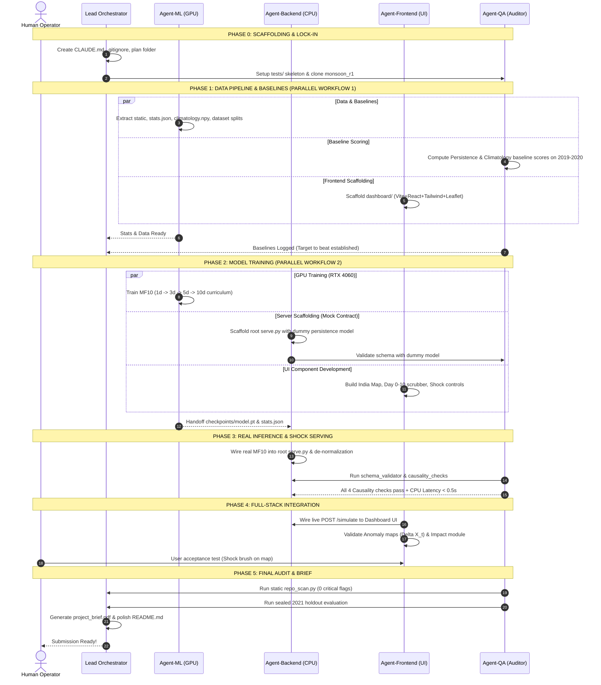

# Multi-AI-Agent Orchestration & Collaboration Plan

> **Hackathon:** Yugaantar DevForge 2026 — Track 2: Multiverse of Monsoon  
> **System:** Antigravity / Multi-Agent Swarm Framework  
> **Purpose:** Detailed operational playbook for orchestrating specialized AI agents in parallel without file conflicts, hallucinated paths, context degradation, or hackathon rule violations.

---

## 1. Multi-Agent Strategy & Architectural Philosophy

Building a full-stack climate digital twin in a fast-paced hackathon requires simultaneous work across **data engineering, deep learning training on GPU, lightweight offline CPU backend serving, interactive frontend development, and rigorous automated grading**.

Attempting to run a single unspecialized agent session across this entire codebase causes:
1. **Context Window Exhaustion:** Early data preprocessing logs and model architectures get truncated or push critical hackathon rules out of context.
2. **Accidental Cross-Contamination:** The agent might "fix" a frontend bug by altering `serve.py` routes, breaking the organizer's strict automated evaluation contract.
3. **Anti-Cheat Tripping:** Frontend or test helpers might introduce hardcoded dates (`YYYY-MM-DD`) or date packages into transitively imported inference code, failing the 15-point `repo_scan.py`.

### The Core Solution: Bounded Multi-Agent Delegation
We split the team into **5 specialized AI agents**, each with **strict file ownership boundaries**, **unambiguous input/output contracts**, and **executable pass/fail gates**.

```
                           ┌──────────────────────────────┐
                           │      LEAD ORCHESTRATOR       │
                           │  Project brief, rules, gates │
                           └──────────────┬───────────────┘
                                          │
       ┌───────────────────┬──────────────┴───────────────┬───────────────────┐
       ▼                   ▼                              ▼                   ▼
┌──────────────┐   ┌──────────────┐               ┌──────────────┐   ┌──────────────┐
│  AGENT-ML    │   │AGENT-BACKEND │               │AGENT-FRONTEND│   │   AGENT-QA   │
│  data/       │   │serve.py      │ ◄───────────► │dashboard/    │   │tests/        │
│  models/     │   │inference/    │  POST /sim    │(React+Vite)  │   │monsoon_r1/   │
│  training/   │   │CPU latency   │  Contract     │              │   │schema check  │
└──────────────┘   └──────────────┘               └──────────────┘   └──────────────┘
```

---

## 2. Agent Roster & Ownership Boundaries

### 2.1 Agent 1: Lead Orchestrator / Project Architect (`Lead-Orchestrator`)
- **Role:** High-level project coordination, milestone validation, cross-agent handoffs, repository cleanliness, and drafting the final 2-Page Brief (`project_brief.pdf`).
- **File Ownership (Write Access):**
  - `CLAUDE.md` (root rules and non-negotiables)
  - `README.md` (submission and project documentation)
  - `docs/` and `plan/`
  - `project_brief.pdf` / markdown source for brief
- **Strict Boundary:** Does not write core model code or frontend components directly; delegates to specialist agents.

### 2.2 Agent 2: ML & Climate Data Engineer (`Agent-ML`)
- **Role:** Data pipeline, chronological dataset splitting, feature normalization, `doy_sincos` rotation, MF10 neural architecture, custom physics-aware losses, and curriculum training execution on NVIDIA RTX 4060 GPU.
- **File Ownership (Write Access):**
  - `data/` (`preprocessing.py`, `dataset.py`, `statistics.py`)
  - `models/` (`encoder.py`, `convlstm.py`, `decoder.py`, `mf10.py`, `physics_losses.py`, `shock_engine.py`)
  - `training/` (`train.py`, `curriculum.py`, `loss.py`)
  - `checkpoints/` (`model.pt`, `training_metadata.json`)
  - Output artifacts: `stats.json`, `climatology.npy`, static terrain tensor.
- **Strict Boundary:** Never touches `serve.py` or `dashboard/`. Never commits raw `.nc` files to git. Never imports external weather APIs.

### 2.3 Agent 3: Backend & Inference Systems Engineer (`Agent-Backend`)
- **Role:** Root `serve.py` server implementation, offline CPU execution optimization, physical de-normalization pipeline, perturbation input handling, and latency benchmarking.
- **File Ownership (Write Access):**
  - `serve.py` (Must live at repository root!)
  - `inference/` (`predictor.py`, `benchmark.py`, `loader.py`)
- **Strict Boundary:** Must NOT move `serve.py` into a subfolder. Must not import `datetime` or date formatting strings. Must load all weights and static tensors at import time (never per-request). Must return raw physical units in plain nested JSON.

### 2.4 Agent 4: Digital Twin Frontend Developer (`Agent-Frontend`)
- **Role:** Interactive web application in `dashboard/` (Vite, React 19, TypeScript, Tailwind CSS, Leaflet, Recharts), India map layers, Day 0–10 time scrubber, Baseline vs. Shock anomaly diff view, interactive Gaussian-smoothed shock drawing brush, and flood/crop impact module.
- **File Ownership (Write Access):**
  - `dashboard/` (Entire directory and all its subfolders)
- **Strict Boundary:** Strictly confined to `dashboard/`. Absolutely NEVER touches Python backend or ML files. Communicates with backend solely via HTTP calls to `http://localhost:8000/simulate` and `/health`.

### 2.5 Agent 5: QA, Evaluation & Anti-Cheat Auditor (`Agent-QA`)
- **Role:** Independent automated verification, scoring harness wrapper, baseline calculations, causality stress-testing, static code security scanning, and pre-submission audit.
- **File Ownership (Write Access):**
  - `tests/` (`test_data_integrity.py`, `test_api.py`, `test_shocks.py`, `test_rollout.py`)
  - `evaluation/` (`eval_scoring.py`, `benchmark_baselines.py`, `verify_submission.py`)
- **Strict Boundary:** Read-only access to `models/`, `serve.py`, and `data/`. Never modifies model weights or backend logic to "make tests pass" — reports exact numerical failures to the appropriate agent.

---

## 3. Strict File Access & Ownership Matrix

| Directory / File | Lead-Orchestrator | Agent-ML | Agent-Backend | Agent-Frontend | Agent-QA |
| :--- | :---: | :---: | :---: | :---: | :---: |
| `CLAUDE.md` / `README.md` | **OWNER (RW)** | Read-Only | Read-Only | Read-Only | Read-Only |
| `plan/` | **OWNER (RW)** | Read-Only | Read-Only | Read-Only | Read-Only |
| `data/` | Read-Only | **OWNER (RW)** | Read-Only | No Access | Read-Only |
| `models/` | Read-Only | **OWNER (RW)** | Read-Only | No Access | Read-Only |
| `training/` | Read-Only | **OWNER (RW)** | Read-Only | No Access | Read-Only |
| `checkpoints/` | Read-Only | **OWNER (RW)** | Read-Only | No Access | Read-Only |
| `serve.py` (root) | Read-Only | Read-Only | **OWNER (RW)** | Read-Only | Read-Only |
| `inference/` | Read-Only | Read-Only | **OWNER (RW)** | No Access | Read-Only |
| `dashboard/` | Read-Only | No Access | No Access | **OWNER (RW)** | Read-Only |
| `tests/` & `evaluation/`| Read-Only | Read-Only | Read-Only | Read-Only | **OWNER (RW)** |

---

## 4. Inter-Agent Communication & Data Contracts

```
[Agent-ML]
   │
   │ Produces: checkpoints/model.pt, stats.json, static.npy
   ▼
[Agent-Backend]  ◄──────────────────────────┐
   │                                        │
   │ Serves: POST /simulate (Port 8000)     │ Audits & Grader
   ▼                                        │
[Agent-Frontend]                       [Agent-QA]
   (Consumes API, renders UI)          (Runs test_api.py,
                                        schema_validator, repo_scan)
```

### Contract 1: ML $\rightarrow$ Backend (Weight & Normalization Handoff)
- **Artifacts Handed Over:**
  1. `checkpoints/model.pt`: Self-contained PyTorch `state_dict` or TorchScript model.
  2. `stats.json`: Per-channel `mean` and `std` derived strictly from 2005–2018 training data.
  3. `static.npy` or embedded tensor: `2 × 32 × 36` static grid (`land_sea_mask`, `orography_m`).
- **Guarantees:**
  - Forward pass signature: `model(x, doy_sincos, perturbation=None)` where `x` is shape `(B, 3, 6, 32, 36)`.
  - Output shape: `(B, steps, 6, 32, 36)`.
  - Model runs in deterministic `eval()` mode with zero GPU dependencies at inference time.

### Contract 2: Backend $\rightarrow$ Frontend (HTTP Wire Contract)
- **Endpoint 1: `GET/POST /health`**
  - Response: `200 OK {"status": "ready", "model_name": "MonsoonFlow-10"}`
- **Endpoint 2: `POST /simulate`**
  - Request:
    ```json
    {
      "init_states": [[[[... 36 values] ... 32 lats] ... 6 channels] ... 3 days],
      "doy_sincos": [0.866, -0.500],
      "steps": 10,
      "perturbation": null
    }
    ```
  - Response:
    ```json
    {
      "rollout": [[[[... 36 values] ... 32 lats] ... 6 channels] ... 10 steps],
      "inference_ms": 142.5
    }
    ```
- **Physical Units Guarantee:** All input and output arrays are physical units (Kelvin, mm/day, m/s, Pa, kg/m²). Frontend never normalizes or de-normalizes; Backend handles it transparently.

### Contract 3: QA $\rightarrow$ All Agents (Executable Quality Gates)
Agent-QA executes the 3 official gate commands:
1. `python -m monsoon_r1.schema_validator http://localhost:8000` (Wire format, shapes, null consistency, 5.0 s timeout).
2. `python -c "from monsoon_r1.repo_scan import scan; import json; print(json.dumps(scan('.'), indent=1))"` (Static anti-cheat check: 0 critical flags).
3. `python evaluation/eval_scoring.py` (Latitude-weighted RMSE, Day 4 persistence check, CSI at $\ge 10\text{ mm/day}$, Day 8 variance ratio).

---

## 5. Parallel Execution Workflow & Phase Synchronization



---

## 6. Ready-to-Use Specialist Agent Prompts

When starting a session or delegating tasks, copy and paste these exact prompts to instantiate each agent:

### Prompt for Agent-ML (Phase 1 & Phase 2)
```text
You are Agent-ML, the Climate Machine Learning Engineer for Yugaantar DevForge Track 2.
Your sole domain is data/, models/, and training/. Do not touch serve.py or dashboard/.
Rules:
1. Chronological splitting ONLY: Train (2005-2018), Val (2019-2020), Sealed Holdout (2021). Never random shuffle.
2. Compute stats.json (mean, std) and climatology.npy (366 days, smoothed) strictly from 2005-2018.
3. Architecture: Implement models/mf10.py (10-channel input: 6 dynamic + 2 static + 2 doy_sincos rotated planes). Multi-scale Residual CNN Encoder -> 2-layer ConvLSTM (64 ch) -> Residual Decoder predicting Delta X.
4. Physical constraints: Enforce tp >= 0 (Softplus/ReLU) and t2m in [233.15, 333.15] K.
5. Physics losses in models/physics_losses.py: Latitude-weighted RMSE + heavy-rain (>= 10 mm/day) loss + Day-8 spatial variance floor >= 0.55.
6. Checkpoint output: Save best weights to checkpoints/model.pt (< 500 MB).
Begin by presenting a step-by-step implementation plan for the data pipeline and baseline dataset. Wait for approval before writing files.
```

### Prompt for Agent-Backend (Phase 2 & Phase 3)
```text
You are Agent-Backend, the Inference Systems Engineer for Yugaantar DevForge Track 2.
Your sole domain is root serve.py and inference/. Do not touch models/ internal training or dashboard/.
Rules:
1. Root serve.py: The file MUST live at the repository root, listening on 0.0.0.0:8000 via FastAPI & Uvicorn.
2. Cold start loading: Load checkpoints/model.pt, stats.json, and static tensors at import time.
3. Wire format: POST /simulate accepts and returns physical units (Kelvin, mm/day, m/s, Pa, kg/m²) in plain JSON lists. Normalize using stats.json on input; de-normalize back to physical units before returning.
4. Perturbation handling: If perturbation tensor is present, add it physically to init_states[-1] before rollout.
5. Zero shock consistency: If perturbation is null or zeros, ensure output exactly matches baseline (atol < 1e-6).
6. Anti-cheat: Never import datetime, time strings, or external weather URLs.
7. Verification: Your deliverable is not done until 'python -m monsoon_r1.schema_validator http://localhost:8000' passes with 0 errors and CPU latency is < 0.5s.
Begin by writing the minimal root serve.py skeleton adhering to the exact contract.
```

### Prompt for Agent-Frontend (Phase 1 & Phase 4)
```text
You are Agent-Frontend, the UI/UX Engineer for Monsoon Multiverse.
Your sole domain is the dashboard/ directory. Never touch any Python files (*.py).
Stack: React 19, TypeScript, Vite, Tailwind CSS, Leaflet/React-Leaflet, Recharts, Lucide-react.
Features to build:
1. India Climate Map: Render 32x36 spatial grid over India coordinates (6.5-37.5°N, 65.5-100.5°E) with layer selector (t2m, tp, wind speed/vectors, msl, tcwv).
2. Time Scrubber: Interactive slider from Day 0 (initial state) to Day 10.
3. Multiverse Shock Lab: Preset buttons ('Warm Bay of Bengal', 'Arabian Sea Wind Stall', 'Reset') and interactive map brush with 2D Gaussian smoothing (sigma ~ 300 km) to draw localized perturbations.
4. Anomaly View: Side-by-side or toggleable Delta X_t = X_t(shock) - X_t(baseline) with divergent colormap (blue-white-red).
5. Downstream Impact Module: Real-time indicators for regional Flood Risk Index and Crop Moisture Stress Index derived from rainfall anomaly outputs.
6. Live Backend Connection: Connect to live POST http://localhost:8000/simulate. Handle loading states, inference latency display, and errors gracefully.
Begin by presenting the component tree and UI architecture plan for dashboard/.
```

### Prompt for Agent-QA (Phase 1 through Phase 5)
```text
You are Agent-QA, the Quality Assurance & Anti-Cheat Auditor for Track 2.
Your sole domain is tests/ and evaluation/. You have read-only access to the rest of the codebase.
Responsibilities:
1. Maintain test_data_integrity.py: Verify coordinate alignment, tensor dimensions, normalization reversibility, and chronological separation.
2. Implement evaluation/eval_scoring.py: Wrap monsoon_r1.scoring to compute lat-weighted RMSE, Day 4 persistence margin, CSI (>= 10 mm/day), and Day-8 variance ratio on validation pool (2019-2020).
3. Validate shocks: Implement test_shocks.py verifying nonzero, localization (>= 60%), outward propagation (> 1.5x), stability (<= 5 sigma), and exact null consistency.
4. Static scan gate: Run 'from monsoon_r1.repo_scan import scan' and verify 0 critical flags, no committed .nc files, and repo size < 2 GB.
5. Report pass/fail numbers objectively with exact file citations without modifying source code directly.
Begin by providing the data integrity and baseline evaluation test plan.
```

---

## 7. Conflict Resolution & Fail-Safe Playbook

### Scenario A: `schema_validator` fails on physical bounds or null consistency
- **Action:** Agent-QA captures error payload. Agent-Backend checks:
  1. Is `Softplus` or clipping applied to `tp` (preventing negative rain)?
  2. Is `torch.no_grad()` and `eval()` active during inference?
  3. Are random dropout layers active? (Disable all stochasticity during evaluation).

### Scenario B: Model exhibits spatial blur at Day 8 (`variance_ratio < 0.40`)
- **Action:** Agent-ML adjusts loss weights in `models/physics_losses.py`:
  1. Increase $\lambda_{\text{var}}$ weight on spatial variance floor.
  2. Increase heavy-rain weight $\lambda_{\text{rain}}$ above $10.0\text{ mm/day}$.
  3. Verify that 10-day curriculum training stage ran with autoregressive loss, not just 1-day MSE.

### Scenario C: Static repo scanner flags hardcoded dates or external URLs
- **Action:** Agent-QA runs AST search across `serve.py` and its transitive imports.
  - Locate all string literals resembling dates (`YYYY-MM-DD`).
  - Move test dates or datetime helpers strictly into `tests/` or `evaluation/`, ensuring `serve.py` has zero transitive imports to them.

### Scenario D: CPU inference exceeds 1.0 second
- **Action:** Agent-Backend profiles forward pass:
  1. Enforce `torch.set_num_threads(4)` at server startup.
  2. Ensure static tensors and model weights are preloaded into memory at module import, not re-allocated per request.
  3. Ensure tensor $\leftrightarrow$ list serialization uses vectorised NumPy buffers.
